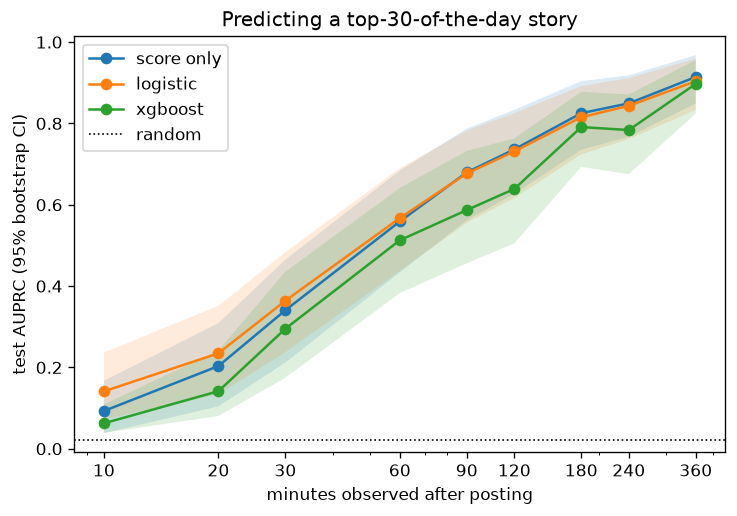
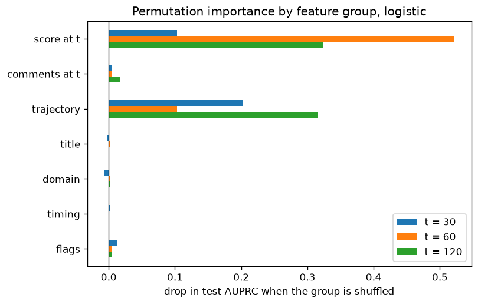

# How early can you tell a Hacker News story will take off?

A Hacker News story's fate is decided in its first couple of hours. This project measures how
much of that fate is knowable at 10, 30, 60 minutes and beyond, using only what a reader could see
at the time, and what kind of information carries the signal.

Headline result: **the votes are the story.** The current score and how it got there explain
essentially all of the predictable variance. Title, domain, and posting time add almost nothing.
A regularized logistic regression beats a tuned XGBoost at every observation time, and from
90 minutes on the raw score alone is as good as any model.



## Data

An asyncio collector (`data/main.py`) polled `/v0/newstories` every 10 minutes for ten days and
re-fetched every story it knew about on each poll for 24 hours. The result is a score and comment
trajectory for every story, not just a snapshot, stored in `data/hn.sqlite`.

| | |
| --- | --- |
| stories | 10,656, posted Feb 4-13 2026 (UTC) |
| snapshots | 655,068, one per story roughly every 10 minutes for 24 h |
| modeling set | 7,840 stories on the 7 fully-labeled days (Feb 5-11); 7,824 of them fetched by 30 min |
| test set | the last 2 of those days, 2,558 stories, 58 positives; never tuned on |
| score at 24 h | 81% below 5 points, 3% at 100 or more |

**Label.** `top30`: the story is in the top 30 of its UTC posting day by score at 24 hours
(2.7% positive). Also `final_score` for regression and a 4-tier bucket.

**Features at time `t`.** Point: log1p of score, comments and direct replies at the latest
snapshot before `t`. Trajectory: score velocity over the last 10 and 30 minutes, score at `t/2`,
minutes to first upvote and first comment (censored at `t`), comments per point. Static: posting
hour and weekday, Show HN / Ask HN flags, missing URL, domain (top 20), TF-IDF over the title.

Stories the collector had not fetched by `t` are excluded at that `t` (1.8% at 10 min, 0.2% at
30). They are late *discoveries*, and they land in the top 30 at ten times the base rate, so a
model trained on them learns the collector's behaviour instead of the story's.

## Results

All numbers are on the held-out days. Confidence intervals are 95% bootstrap over test rows.

**Observation time** (`models/01_observation_curve.ipynb`). Test AUPRC for the top-30 label;
random ranking scores 0.023.

| minutes observed | score only | logistic | XGBoost |
| --- | --- | --- | --- |
| 10 | 0.09 | 0.14 | 0.06 |
| 30 | 0.34 | 0.36 | 0.30 |
| 60 | 0.56 | 0.57 | 0.51 |
| 120 | 0.74 | 0.73 | 0.64 |
| 360 | 0.91 | 0.90 | 0.90 |

At 30 minutes, logistic AUPRC is 0.36 [0.24, 0.48] and AUROC 0.87 [0.82, 0.91]. If a curator
picked the 30 most promising stories each day at the 30-minute mark, about 37% of them would end
up in the day's top 30. Both learned models reweight the positive class and are badly
overcalibrated; their outputs rank well but are not probabilities.

**Trajectory vs endpoint** (`models/02_trajectory_vs_point.ipynb`). Adding the shape of the
curve to the point features, paired bootstrap on the AUPRC difference:

| minutes | logistic gain | XGBoost gain |
| --- | --- | --- |
| 30 | +0.03 [0.00, 0.06] | +0.03 [-0.03, 0.10] |
| 60 | +0.07 [0.02, 0.12] | +0.07 [0.01, 0.14] |
| 120 | 0.00 [-0.06, 0.06] | +0.09 [0.02, 0.17] |

Group permutation importance on the test set: shuffling the score or trajectory columns costs
0.1 to 0.5 AUPRC; shuffling title, domain or timing costs at most 0.01.



**Predicting the score itself** (`models/03_targets.ipynb`). An XGBoost regressor on
`log1p(score at 24h)` reaches RMSE 0.74 at 30 minutes (1.00 for predicting the mean) and
Spearman 0.65, rising to 0.57 and 0.76 at 60 minutes. Ranking by the predicted score recovers
the top-30 task *better* than the dedicated classifier (0.38 vs 0.33 AUPRC at 30 min, 0.63 vs
0.58 at 60): the binary label discards the ordering among negatives that teaches the model what
taking off looks like.

**Where it is wrong** (`models/04_error_analysis.ipynb`). The 36 missed top-30 stories averaged
2.5 points at 30 minutes against 31.6 for the caught ones. They were not misread; they were
indistinguishable from the 2,400 other two-point stories, and were typically posted earlier in
the UTC day. False alarms are mostly mainstream news and politics with a strong start that
plateaued, which HN's ranking penalises in ways the API does not expose.

## Limitations

- Ten days of data, 206 positives. Day-of-week effects are not identifiable and the two test
  days give coarse estimates; the intervals are wide and honest.
- The label is relative to the posting day, so a quiet day's number 30 may have fewer points
  than a busy day's number 50.
- HN's flagging, vouching and politics penalties are not in the API. Several false alarms look
  like penalised stories.
- v1 of this project (`models/eda.ipynb`, `models/modeling.ipynb`) used a Snowflake view of a
  4,067-story subset with two snapshots per story and reported a tuned 3-fold CV AUPRC of 0.35
  with no holdout. Those notebooks are kept for reference and no longer run.

## Run

```bash
uv sync                      # or: pip install -e .
uv run pytest                # dataset invariants against data/hn.sqlite
cd models && uv run jupyter nbconvert --to notebook --execute --inplace 0*.ipynb
```

Each notebook executes in one to four minutes. `src/hn/` holds the dataset builder (`dataset.build(t_minutes)`),
labels, features, the shared sklearn pipeline, and the bootstrap evaluation helpers.

To collect more data: `cd data && bash collect.sh` (see `main.py --help`); `export.sh` dumps the
tables to CSV.
